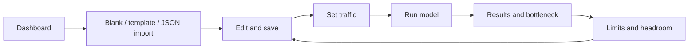

# STRESSFORGE — Phase 2 plan and planning review

**Date:** 2026-10-22 (Asia/Dhaka)
**Status:** Proposed implementation plan; Phase 2 code has not been built or verified.
**Baseline:** a39454f; Phase 1 audit verdict remains **Partial**.
**Owner:** course project author; each milestone may be executed in a separate coding session.

## Outcome

A signed-in user can create a design, draw and connect components, save/reopen it, choose traffic, run a model-based stress test, inspect its bottleneck and limits, change the design, and run again. The screens must follow the existing prototype. Results are estimates from a mathematical model, not measurements produced by sending real load to infrastructure.

The core user journey is:

## Sources and what is confirmed

- [Progress report](STRESSFORGE-PROGRESS-REPORT.md): Phase 1 findings F1–F14 and verification gaps. A published Phase 1 commit does not imply its audit passed.
- [Architecture](ARCHITECTURE.md): intended DesignsModule, pure SimulationModule, JSONB graph, ownership, /simulate and /limits endpoints.
- [Phase 1 specification](../nest-boilerplate/nest-boilerplate/docs/stressforge/PHASE-1-PROMPT.md): Phase 2 handoff and explicit later-phase boundaries.
- [Prototype](../nest-boilerplate/nest-boilerplate/docs/stressforge/reference/architecture-stress-test.html): SECTION 3 fixtures, 4 store/undo, 5 routes, 10 dashboard, 11 creation flows, 12–14 workspace/editor, 15 charts, 16 Traffic/Results/Limits. Read only relevant sections when implementing.
- [Engine](../nest-boilerplate/nest-boilerplate/docs/stressforge/reference/mock-engine.js): catalog, validation, routing, simulation, paths, limits and timeline. Its header calls simulation /runs, while ARCHITECTURE.md calls it /simulate; this plan selects /simulate.
- Current frontend route registry and package scripts: existing destinations and UI foundations are reusable. No new frontend route is needed for the core loop.

The scope below is a **proposal derived from these sources**, not a claim that a complete Phase 2 build specification already exists.

## Scope

| Build in Phase 2 | Keep for later phases |
| --- | --- |
| Owned designs API and saved graph/traffic | Sharing, public examples and read-only links |
| Pure TypeScript simulation engine and validation | Real AI generation, chat models and paid APIs |
| Dashboard backed by saved designs/latest runs | Improve/History/Compare/Report/Notes screens |
| Blank, six source templates and JSON import | Public Learn, Challenges, Evaluation, Settings and onboarding |
| SVG canvas, properties, connection tools, undo/redo, zoom/pan and load overlay | Collaborative editing, WebSockets and server-side undo history |
| Traffic, Results and Limits tabs | Real infrastructure load testing and calibration studies |
| Minimal persisted run snapshots for latest/recent results | Full version history, restore, comparison and PDF export |

The standalone /designs listing stays a Phase 3 placeholder, matching the registry; Phase 2 design discovery uses the dashboard. /templates stays a Phase 4 library placeholder; /new/template provides the Phase 2 picker.

**Describe in words needs an explicit mock boundary.** The prototype places /new/describe in Phase 2, but its MockAI.draft is scripted. Port that flow only as a clearly labelled local scripted demonstration, preserving assumptions. It may create a normal saved design after validation. It must not be presented as real AI, consume an AI quota, or call a model. Reuse the same backend template/build helpers where practical; do not place actual AI work in this phase. The course requirement for central AI is addressed in the later AI phase and is not satisfied by this mock.

## Milestones and dependencies

Each milestone has reviewable substeps; P2/P3/P5 are deliberately split rather than treated as single large PRs. Use codex/ branches if creating new branches. Keep local environment files out of Git. No publishing or deployment is required by this planning document.

| Step | Deliverable and context | Depends on | Exit evidence |
| --- | --- | --- | --- |
| P0 | Repair Phase 1 prerequisites; add client regression-test setup; no Phase 2 feature counted here | None | Auth/client regressions pass; parser/race fixes checked; dependency triage, test typing and Node 22 evidence recorded |
| P1 | Freeze graph/traffic/result contracts and API semantics; identify prototype parity fixtures | P0 for integration readiness | Reviewed DTO examples; draft-vs-runnable cases; finite JSON strategy; ownership/conflict/limit errors; initial OpenAPI contract and tests |
| P2a/P2b | First pure engine + numerical fixtures, then bounded worker execution | P1; P2b follows P2a | Six-template parity and documented exceptions; deterministic behavior; worker cancellation/deadline/priority tests |
| P3a/P3b | First design CRUD/revision/ownership, then durable run lifecycle and compute integration | P1; P3b also needs P2b | Fresh migrations; real-service owner/conflict tests; pending/completed/failed/restart/duplicate/retention tests |
| P4 | Early full slice + browser/editor test harness; then dashboard/creation flows | P3b | Create → save → run simple Clients→App→DB → show minimal result → reopen passes first; then templates/import/mock describe |
| P5a/P5b | First SVG nodes/selection/movement; then edges/properties/zoom and keyboard alternatives | P4 | Test each substep before expanding; all 12 types, no render-time requests, save/reload works |
| P6 | Undo/redo, autosave/conflict recovery, validation, server preview/load overlay | P5b + P2b | Rapid edits/out-of-order responses do not lose state; offline/expired session/conflict recovery tested; live preview uses the same engine |
| P7 | Traffic, Results, Limits tabs and SVG charts; dashboard latest/recent summaries | P3b + P6 | Every output labels units/snapshot; stale results identified; bottleneck points to a real node; invalid/unbounded/zero-load cases render correctly |
| P8 | Full acceptance pass, docs/demo evidence and progress-report update | P0–P7 | All checks and full browser matrix pass; defects closed or explicitly unresolved; Phase 1 reassessed and Phase 2 verdict evidence recorded |

P1 contracts/parity research and P2 isolated engine work can be explored while P0 fixes are under way; do not integrate protected write flows until the auth gate passes. Canvas rendering work can proceed against stable fixtures after P1, but acceptance must use the real API. Do not parallelize edits to shared DTOs, generated schema or the route registry without coordination.

**Rollback:** keep each milestone's work separate. Revert feature commits or disable unfinished entry points; never use destructive resets against shared work. Exercise migration up/down only on disposable databases. An applied migration rollback that drops data is not a production recovery strategy.

## P0: carry the audit findings forward

Fix F1/F2 first: revocation lifetime and failed logout writes are security dependencies of every protected Phase 2 action. Fix F4–F7 before relying on conflict/error UI. Triage F3 package advisories by reachability instead of blindly upgrading everything. Repair test typing and run Node 22. Complete the UI/doc gaps F8–F14 before the final Phase 2 acceptance pass.

Convert the five expected-failure tests in phase1-audit.spec.ts into ordinary tests when their corresponding defects are repaired. The standalone phase1-regressions.cjs must then pass; do not weaken assertions or count an expected failure as successful behavior. Keep old audit history and append new verification evidence.

## Contracts, persistence and API

### Data model

- **designs:** UUID id, ownerId foreign key, name/description, source kind/template reference, graph JSONB, traffic JSONB, schemaVersion, monotonically increasing revision, createdAt/updatedAt.
- **design_runs:** UUID id, designId, enforced owning-user association, kind (simulation/limits), design revision, immutable graph/traffic snapshot, computation fingerprint, engineVersion, status (pending/completed/failed), nullable result JSONB, safe failure reason, requestId, createdAt/completedAt. Unique (designId, requestId).
- Use explicit migrations, synchronize:false, ownership/update indexes and bounded pagination. Do not add version-history or general account-management tables.
- A completed run is persisted transactionally with its immutable input/result; a run based on revision N must never be relabelled as revision N+1. Design deletion removes dependent run data in a transaction, after confirmation in the UI.
- Retain every accepted run/requestId for at least 24 hours, and the latest 50 terminal runs per design thereafter. Never prune pending rows or entries inside that idempotency window. Proposed admission cap: 50 accepted calculations per design per rolling 24 hours, plus the per-user concurrency bound, to limit storage/work. Dashboard run counts must be labelled as retained-window counts unless separate counters are introduced. This is bounded storage, not the Phase 3 History feature.

### Two different validation levels

1. **Safe stored draft:** valid JSON shape, supported node types, unique safe IDs, finite coordinates/properties, valid edge references, bounded values and payload size. An empty canvas, missing entry connection, cycle or unreachable component can still be saved.
2. **Runnable graph:** semantic validation adds missing entry, cycles and other engine issues. A non-runnable draft returns structured issues and cannot run. Unreachable nodes and queue-without-workers preserve the prototype's warning/error classifications unless a documented correctness fix is necessary.

Reject malformed/dangling edges, duplicate IDs, unknown component types and dangerous object-key IDs such as __proto__/constructor before entering the engine. Prefer Map/null-prototype lookups over ordinary objects. Preventing lost draft work is different from permitting invalid calculations. Do not repeat the earlier suggestion to reject every cycle at save time.

### Proposed endpoints

All paths below have the /v1 prefix and require auth. Existing response envelopes and existing error codes remain stable.

| Method/path | Purpose |
| --- | --- |
| GET /simulation/catalog | Component definitions/defaults, regions and traffic presets, JSON-safe |
| GET /templates | Six source template definitions/graphs; this is API data, not the later frontend library route |
| POST /designs | Create blank/template/import/scripted draft after safe-shape checks |
| GET /designs | Paginated owner-only summaries; no full run histories |
| GET/PATCH/DELETE /designs/:id | Read/update/delete owned design; PATCH includes expectedRevision |
| POST /designs/:id/validate | Validate current saved draft and return runnable errors/warnings |
| POST /simulation/preview | Bounded transient preview of current draft; no save/run-history writes |
| POST /designs/:id/simulate | Reserve an immutable simulation job for expectedRevision + UUID requestId; return 202 with runId/status URL |
| POST /designs/:id/limits | Reserve the same bounded job lifecycle with kind=limits; return 202 and persist the limits result/fingerprint |
| GET /designs/:id/runs/:runId | Poll/reopen owned pending/completed/failed calculation, including kind; no History UI |
| GET /dashboard | Owner-only counts, stale/latest summaries and a bounded recent-run list |

Use route ordering to avoid static paths being captured by dynamic IDs. Read endpoints return 200; creating a design returns 201; accepting a new explicit calculation returns 202; deletion returns 204. Both unknown ID and ownership behavior must be intentional: proposed 404 for absent design, 403 for existing other-owner design, consistent with the Phase 1 system page; do not expose its name/owner metadata.

**Proposed contract extension:** add CONFLICT (409) for revision mismatch and requestId reuse with different input. This requires coordinated backend error enum/filter, OpenAPI DTO/types, ApiError union and inline editor recovery; it must not open a generic server-error page. Duplicate-email validation and all original Phase 1 codes retain their existing semantics.

PATCH performs an atomic owner+revision conditional update. On conflict, retain the local draft and offer reload/reapply; never silently overwrite another tab's save. Repeating simulate/limits with the same requestId and same input/kind returns the same run within the 24-hour guarantee: 202 while pending, 200 for a terminal record. Different input/kind under that key is 409. Return a failed run as status=failed; pressing Retry uses a new UUID. Beyond the published guarantee a pruned key may be accepted again, so the client must not automatically retry an old submission indefinitely.

**Durable calculation lifecycle:**

1. Authorize current design ownership, then look up (designId, requestId) before current-revision validation or admission checks. A retained matching request returns its original snapshot/status even when the design has changed or the queue is full. Compare its original kind/expectedRevision; a changed identity under the same key is CONFLICT.
2. Only for a new key, read/capture the expected revision and validate its runnable snapshot, then provisionally reserve bounded worker/queue admission. If capacity is full, recheck the requestId once to catch a concurrent winning reservation before returning RATE_LIMITED. Do not insert an unschedulable pending record.
3. In a short transaction, recheck owner/revision and atomically insert immutable inputs plus the pending reservation. Resolve uniqueness races by returning the winning matching request. Release provisional admission whenever the transaction fails or discovers an existing reservation. Only the insertion winner enqueues one job.
4. Respond 202 and execute outside the DB transaction. The browser polls the owned status URL until completed or failed. A normal browser disconnect does not cancel an accepted durable job.
5. Atomically finalize only a still-pending row. Timeout/crash becomes failed with failure.code=UNAVAILABLE and reason=COMPUTE_INTERRUPTED; never fabricate a result. At single-instance startup, mark interrupted pending jobs failed rather than leaving them pending forever. Multiple API-instance deployment would require worker ownership/leases and is outside this local plan.
6. If the design is deleted during calculation, cascade its jobs and cancel/drop queued/running work; a late result must not recreate rows. Later reads return NOT_FOUND. Retention removes only eligible terminal records after the idempotency window; failed jobs still count toward the admission window.

Test identical retry after the design advances, retry while admission is full, concurrent insertion/admission races, crash-before-finalize, restart, deletion and pruning. An identical retry must not receive a spurious 409/429 or consume another worker slot.

Both simulation and limits jobs use this lifecycle; transient previews do not create durable rows.

### JSON and model identity

Internal Infinity cannot be sent as a bare JSON number: JSON.stringify would silently turn it into null. Use explicit wire states such as {kind:"finite", value:123} or {kind:"unbounded"} for non-finite metrics/catalog capacities; invalid numeric output fails validation rather than silently disappearing. Keep scalar arrays for charts finite and document omitted/unbounded points.

“Not broken within the searched range” is not a proof of infinite capacity. If findLimits reaches its search cap, report notReached plus testedUpToRps.

**Approved reference-parity exception:** the source calls failure at 1 rps floor=true and breakRps=0. That does not establish failure at arbitrarily small load. Expose this as failsAtMinimumLoad with minimumTestedRps=1 and an unknown lower threshold, not a proven zero-capacity/latency floor. Do not label a true latency floor unless an independent low-load service/transport baseline establishes it. Tests must include both a low-capacity design that passes below 1 rps and a genuine baseline-latency violation. Preserve other source behavior unless a separate documented exception is reviewed.

Store schemaVersion and engineVersion. A computation fingerprint covers engine-relevant graph/traffic fields, respecting the prototype's deterministic seeding; layout-only moves do not require fresh metrics. Save revisions still protect all writes. Show the revision/fingerprint used for each result; edited designs must not silently display old metrics as current.

## Engine and resource controls

Port validate, simulate, paths, findLimits, timeline, catalog/traffic helpers and layout/template builders as small plain TypeScript modules. Nest services handle auth, DTOs, worker execution and persistence. Keep one authoritative numerical implementation; the browser renders server outputs and may perform inexpensive structural checks.

Keep the original reference engine unchanged as a parity oracle. Capture all six template fixtures with identical normalized inputs. Compare numeric fields with documented tolerances and compare structural/status fields exactly. A discrepancy requires an explicit decision: port bug, intentional wire normalization, or approved reference-model exception. The 1-rps floor exception above is already approved by this plan; parity must not reintroduce the misleading claim.

The source uses a Sakasegawa waiting approximation, inferred server counts, a saturation clamp and lognormal latency mixtures. Do not claim exact M/M/c or exact end-to-end percentile accuracy. Use an analytically simple M/M/1 case where the model assumptions align; test percentiles/order/conservation and narrowly scoped monotonic properties separately. Real calibration remains a later Evaluation task. timeline() independently evaluates sampled loads with seeded jitter; it does not advance queue state over time. Label it “illustrative sampled timeline.” The source limits order is based on unshed demand, so label it “predicted saturation order under unshed demand,” not observed sequential failure. Transient queue simulation and measured failure sequencing are outside this phase.

Proposed initial bounds, to be profiled in P2 rather than represented as measured performance:

- 50 nodes, 200 edges, 64 KiB import; server parser maximum remains independently enforced.
- Positive finite capacities for finite-capacity component types, nonnegative bounded latencies (including zero for Clients), replicas 1–100, read/hit ratios 0–1; finite bounded traffic/duration/burst and supported enum values. Freeze exact upper limits in P1 DTOs after checking all prototype fixtures.
- Fixed curve/timeline point limits; bounded path expansion and search iterations. Validate before recursive walking. Graph size alone does not bound exponential paths.
- One persistent worker_threads worker initially, a small bounded queue (4 proposed) and one active calculation per user; refuse excess requests with RATE_LIMITED. Use Node's standard library, not a new paid service.
- Proposed 5-second total calculation deadline, including queue wait; expired queued work fails/releases capacity, and over-budget running workers are terminated/replaced. Durable jobs record failure and remain pollable. A Promise.race timeout on the main thread does not interrupt CPU-bound JavaScript.
- Measure template and maximum-supported branching graphs for elapsed time, event-loop responsiveness and memory. Tune limits from evidence and record the supported envelope before acceptance.
- Do not add Bull jobs, WebSockets, hosted compute or caching as prerequisites. Existing Redis continues to support sessions/rate limits; numerical results must not depend on Redis cache availability.

## Frontend behavior

**Canvas:** port SECTION 13/14 SVG interactions, not a new diagram library. Include all 12 catalog types, select/move/connect/remove, properties, regions/replicas, accessible labels and keyboard connection alternatives, pan/zoom/fit, selection outline, validation badges, load overlay and a capped/coalesced undo stack. Distinguish screen coordinates from world coordinates; test dragging at different zoom levels. Deleting a node removes its edges as one undoable change.

**State:** keep server query state in TanStack Query; use a focused editor reducer for draft, selection and undo/redo. Mount the in-memory draft provider above AppShell's conditional system-screen replacement: a page-local reducer would be destroyed when a network/error state unmounts the editor. Key drafts by userId/designId and clear them on confirmed explicit logout/account switch to prevent cross-account state leakage. Do not persist access tokens. Debounce autosave (750 ms initial proposal), serialize writes per design, and coalesce rapid changes. Drag locally and save at gesture end. Display Unsaved/Saving/Saved/Failed honestly. Retain an in-memory draft on auth/network/conflict errors; guard navigation while dirty. State survives session-modal re-login. Reload/closing a tab during a failed save can lose memory-only edits; warn clearly. Browser-persistent draft recovery is a separate explicit design decision, not a silent storage addition.

**Preview:** debounce semantic changes and send editorSessionId (UUID), a monotonic sequence and fingerprint. The server keys supersession by authenticated userId + editorSessionId, retains only the newest queued preview, and drops/terminates obsolete preview work. Client abort/disconnect also cancels ephemeral preview work and releases queue capacity. Ignore late responses by sequence/fingerprint.

Explicit Run/Limits **must** outrank previews. With one worker, a durable job may preempt a running preview; a new preview never cancels an accepted durable job. Suppress the editor's previews while its explicit run is active. Treat preview RATE_LIMITED with the client's silent error mode and an inline “preview paused” indicator, not a global system-state replacement. Test that queue saturation preserves editing and explicit Run still proceeds. Never calculate a second numerical engine in the browser to fake live metrics; show the last preview as stale while a newer one is pending.

**Traffic:** port presets, request rate, burst multiplier, read share, duration/shape, user region, p95 target and error budget. Preserve units and defaults from the prototype. Cancel/reset stale calculations when relevant values change.

**Results:** verdict, p50/p95/p99, errors, throughput, node utilization, bottleneck, request paths, timeline and source-labelled charts, including the illustrative timeline disclaimer. A bottleneck link selects the matching node in Edit. Restrict suggested improvement content to any existing scripted explanation; no Apply AI fixes loop.

**Limits:** breaking point or notReached range, headroom, failure order and ramp curve. Differentiate current traffic, peak/burst traffic and returned search interval. Zero load, failure at the minimum tested load, independently established baseline-latency failure, queues with backlog and search-cap cases need specific display cases.

**Creation/dashboard:** six exact template fixtures; empty or client-only blank draft; file/paste JSON errors without creating a half-valid design; owned cards and recent runs from persisted snapshots. Never perform all limit searches on every dashboard render; show saved summaries/stale state and compute only explicitly or through bounded preview.

## Verification and completion criteria

Keep tests alongside each milestone; do not leave testing to P8.

| Layer | Required evidence |
| --- | --- |
| Contracts | Unknown/duplicate/reserved IDs, dangling/self edges, non-finite/negative/out-of-range values, excessive sizes; safe draft vs runnable distinction; JSON round-trip without ambiguous nulls |
| Engine | Six-template parity; zero/burst/overload cases; cache reads/write bypass; replica write-replay cost; queues/backlog; multi-region RTT; deterministic seeds; lower/upper search bounds; bounded branching/path expansion |
| Persistence/security | Fresh migration/seed; two real users; owner A cannot read/update/delete/run owner B; server ignores client owner/role; conditional save race; SQL constraints; immutable snapshots; idempotent duplicate run |
| Integration | Real Postgres and real Redis suite, in addition to existing doubles; expire/revoke session; worker timeout/crash/queue saturation; parser failures; unavailable dependencies |
| Editor | Undo/redo/coalescing; zoomed drag; edge/node deletion; invalid-but-saveable cycle; reload after successful save; failed-save navigation; re-login preserves draft; multi-tab conflict; late preview/result cannot replace current output |
| Browser | Create/import/template/labelled describe → edit → traffic → results → limits → edit/run again; restart/reopen; keyboard-only essentials; 1440/~1024 in light/dark; no unexpected console errors/overflow |
| Toolchain | Node 22; API build, read-only lint, typecheck, unit/e2e; WEB build/lint/typecheck/check:routes; regenerate API types and inspect diff |
| Reporting | Update the same progress report with checklist, observed commands, limitations, fixes and reassessed Phase 1 items; never remove earlier failure history |

Add the maintained client regression runner in P0 and editor/browser test scaffolding before P4 acceptance; P5/P6 add interaction/state tests to that setup. Any new test-only dependencies must be justified and local/free. The runtime dependency goal remains no new chart/diagram/state-management package unless a demonstrated requirement justifies one.

Phase 2 is complete only when all mandatory items above have passing observed evidence, required Phase 1 blockers are fixed, the report is updated, and remaining intentional later-phase screens still clearly say which phase supplies them. A rendering demo or engine parity alone is insufficient.

## Effort and execution sequence

Use work sessions, not a calendar promise. A session means roughly 2–4 focused hours, including verification and notes.

| Work | Planning allowance |
| --- | --- |
| P0 Phase 1 remediation | 3–6+ sessions; package triage may change this substantially |
| P1 contracts | 1–2 sessions |
| P2 numerical engine/workers | 3–5 sessions |
| P3 API/persistence + durable run lifecycle | 4–6 sessions |
| P4 creation/dashboard | 2–3 sessions |
| P5/P6 canvas/state/autosave | 5–8 sessions combined |
| P7 Traffic/Results/Limits | 3–5 sessions |
| P8 acceptance/docs | 2–3 sessions |

Total initial allowance: **23–38+ sessions**, before unforeseen rework; re-estimate after P0 and P2. These are planning judgments, not measured implementation times or a delivery commitment.

Aim for the first full slice early: login → create blank → save → run a simple Clients→App→DB graph → show server result → reopen. Then complete the rich canvas and tabs. If time is constrained, keep that slice coherent and mark Phase 2 partial; do not move mandatory scope into an invisible “later” list while calling it complete.

## Planning review

**Initial assessment:** the feature sequence is feasible for the existing stack, but it needs the safeguards below. The biggest implementation effort is the editor/save lifecycle; the biggest correctness risk is preserving numerical behavior while explaining what the model does and does not predict.

| Review concern | Decision incorporated | Remaining validation |
| --- | --- | --- |
| Phase 1 was treated as complete in an earlier discussion | P0 explicitly gates integration and P8 reassesses earlier requirements | Execute fixes and record evidence; this plan does not close audit findings |
| Earlier advice rejected cycles at save time | Safe drafts can contain semantic errors; Run validates separately | Empty/cyclic save/reload tests |
| /runs vs /simulate naming conflicts | Select documented /simulate; retain run IDs for persisted snapshots | P1 OpenAPI review |
| Future phase scope could expand accidentally | Minimal run persistence only; no History/Compare/Share/real AI; describe remains labelled mock | Route/feature checklist at each milestone |
| API-only run button would lose prototype's live bar | Bounded preview, explicit supersession/cancellation, mandatory durable-job priority and inline overload | Worker/preview saturation and stale-response tests |
| Infinity/NaN silently corrupt JSON results | Explicit wire states and notReached search-cap interpretation | Catalog/result schema and round-trip tests |
| Math parity could preserve incorrect claims | Separate parity/analytic checks/calibration; approve failsAtMinimumLoad exception; label sampled timeline and unshed saturation order | Counterexample, genuine baseline-latency fixture and clear UI labels |
| Autosave/system screens can lose editor state | Serial saves, revisions, draft provider surviving system-screen unmounts, navigation guard and explicit logout clearing | Delayed responses, offline/401/500 transitions, two-tab and account-switch tests |
| CPU and path explosion can freeze the API | Bounded workers/queue/path expansion and termination budget | Profile worst supported graph; demonstrate event-loop responsiveness |
| User authorization can be bypassed through body/run IDs | Server-owned ownerId and authorization for all design/run operations | Two-user real-service e2e suite |

**Independent review outcome (2026-10-22):** the reviewer identified three pre-implementation blockers (run lifecycle/idempotency, preview cancellation/priority, false 1-rps floor classification) and two execution/labeling improvements. This revision defines the pending/completed/failed protocol and retry window, mandatory preview scheduling and inline overload, the demonstrated parity exception, precise timeline/order labels, and smaller substeps with early test setup/full slice. A further local consistency pass placed draft state above system-screen unmounts. These are resolved planning gaps, not verified implementations.

Overall planning verdict: suitable for staged execution beginning with P0/P1; the numerical port, editor lifecycle and durable worker jobs remain the highest-risk implementation areas. Estimates were increased for the run lifecycle. No performance or numerical accuracy claim is verified by this document. Remaining technical decisions are exact DTO bounds, output tolerance values, measured worker limits, run-retention policy and any persistent local-draft recovery; resolve them in P1/P2 and record decisions before dependent work.

### Review protocol and living-plan maintenance

Record review findings and resolutions below. For any scope change, state why, update dependencies/acceptance criteria and re-estimate affected milestones; retain the original decision in dated history. Each completed milestone updates STRESSFORGE-PROGRESS-REPORT.md with actual evidence and rechecks affected Phase 1 behavior. No automatic future update mechanism is configured.

## History

- 2026-10-22: Draft plan created from the inspected Phase 1 audit, architecture, prototype sections and reference engine. All Phase 2 implementation/verification remains pending.

### Reference smoke-check evidence (2026-10-22)

The unchanged reference engine was evaluated in an isolated Node VM, then all six SECTION 3 template specs were built, validated and simulated. All six validate and simulate successfully. The engine exposes 12 component types. Reference SHA256: e841b1afe3f2897cab9405d86bd4f735f977e5c0ce950ebbab7f621e54f7d78f.

| Template | Nodes/edges | Verdict at source traffic | p95 (ms, rounded for this planning note) |
| --- | --- | --- | --- |
| three-tier | 5/4 | fail | 312.983 |
| content | 7/6 | pass | 45.739 |
| ingest | 6/6 | strained | 43.501 |
| checkout | 10/10 | fail | 1572.243 |
| mvp | 3/2 | pass | 43.143 |
| media | 7/6 | pass | 60.175 |

These are observed reference-model outputs, not Phase 2 backend results or real-system measurements. P2 must capture full-precision fixtures and documented tolerances; do not use this rounded table as the entire test oracle. “Working template” means valid graph, not guaranteed passing at its preset traffic.

### Independent review counterexample (2026-10-22)

A valid Clients→App graph, app capacity=1 request/s, latency=1 ms, burst=2, readRatio=1, p95 target=300 ms and error budget=0.01 was run against the unchanged source. At 0.1 rps it passes (p95≈2.126 ms, errors=0); at 1 rps it fails (errors≈0.50001). Yet source findLimits returns breakRps=0, floor=true, cause=errors. This observed counterexample justifies the wire/UI exception above; no reference-engine source was changed.

- 2026-10-22: Independent planning review completed; lifecycle, retry retention, preview scheduling, numerical labels and milestone/test dependencies revised. These changes affect documentation only.

- 2026-10-22: Follow-up review found duplicate-retry ordering ambiguity. Final protocol now performs retained-request lookup before current-revision/admission checks, with a second lookup on admission saturation to resolve concurrent winners. Only a new insertion winner enqueues work.
